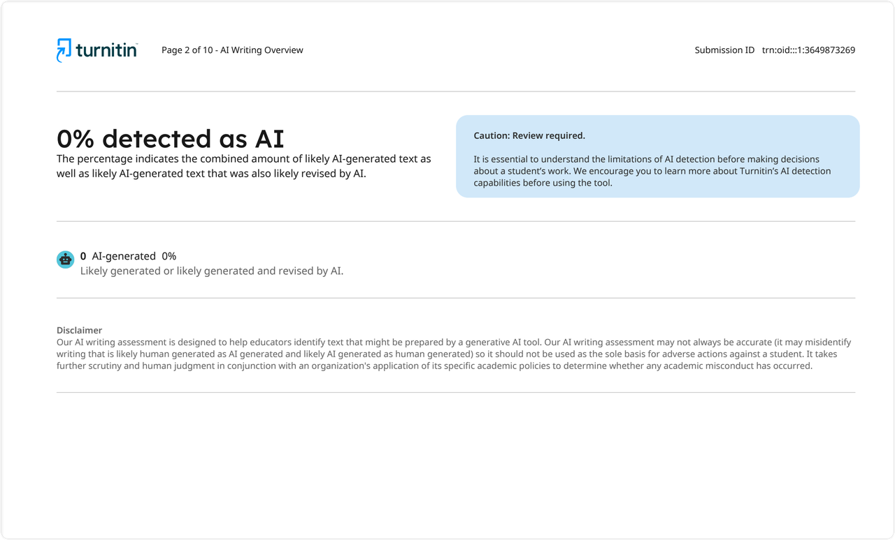

# 2026Turnitin总误判？实测英文降AI率超稳方法！ai率轻松降到 0%

真不止我一个留学生被新版 **turnitin** 搞得头大吧！明明是自己查文献、逐字写完的英文 Essay，做一次**英文ai率检测**，结果却比预想高很多。我还用 **ZeroGPT、Copyleaks、Originality、AI Detector **这些主流 **AI Checker** 交叉测了几次，结果依旧不太稳定。为了处理**英文降ai率**，我也试过不少**英文aigc检测免费**平台和改写工具，换词、调语序来回折腾，文章虽然改了不少，但整体读感还是有点生硬，想靠简单 **Humanize AI** 很难解决。后来踩了不少坑，才开始用笔灵AI辅助优化英文文稿，主要调整句式和表达节奏，再自己通读修改。不同平台结果本来就会有差异，所以我现在更看重文章本身是否自然、观点和专业内容有没有被改动。

## 一、别瞎改！新版Turnitin误判根本不是你写得差

很多同学遇到**AI率超标**，第一反应就是疯狂改论文、重写段落，最后越改越乱，甚至改错核心内容。其实大家完全没必要自我怀疑，**2026年Turnitin**完成算法大迭代，检测逻辑早就全面更新。

现在的检测不再局限于简单查重，重点抓取文本的底层行文节奏、句式规整度、逻辑输出习惯。我们留学生写的学术英文，普遍句式工整、逻辑严谨、用词规范，刚好契合AI写作的典型特征，所以极易被系统误判。

重点提醒：目前绝大多数手写稿AI超标，都是算法误判！主动做**英文降ai率**、优化文本真人质感，是保护原创成果，不属于学术违规，大家不用有心理负担。

另外网上流传的老旧改稿、洗稿方法，现在已经全部失效，浅层换词调序，所有**AI Checker**都能轻松识别，纯属无效改稿。

## 二、全网实测对比｜为什么我只留笔灵AI？

为了找到靠谱的**英文降ai率**方法，我前后试了不少工具，有的改完太口语化，有的机器感还是很明显。后来用笔灵AI辅助优化英文文稿，句式和表达自然了不少，学术语气也比较容易保留。

传送门：[笔灵英文降AI](https://ibiling.cn/paper-pass/english?from=githubywjiangai1009jw)
给大家看我的真实实测数据：手头一篇商科课程Essay，初始**英文ai率检测**高达89%，属于学校明确禁止的高危区间，随时可能被约谈扣分。用笔灵AI一键优化后，全程无手动大改，AI率直接降到9%的安全区间！我连续用多个**免费在线查 ai 率英文**平台复测，Turnitin、Copyleaks、Originality全部顺利通过，零标蓝、零误判，真正实现高效Humanize AI。

## 三、留学生刚需！笔灵AI三大核心优势

不同于普通只做同义词替换的工具，笔灵AI更注重从整体句式和表达节奏上优化文本，不只是简单换几个词。它会适当打散过于规整的句式和模板化表达，让英文文稿读起来更自然，对留学生做**英文降ai率**来说更实用。

比较让我满意的是，它可以锁定论文里的专业术语、实验数据、核心论点和文献引用，主要优化生硬、模板化的表达，不轻易改动原本的专业内容，课程作业、毕业论文、期刊论文都可以用。

另外支持整篇英文文档上传，原有段落、表格、注释等格式基本可以保留，不需要反复重新排版。改写前后字数变化也比较小，基本不用为了满足Essay或论文的字数要求再来回增删，赶稿时确实省事不少。

## 四、手动微调小技巧

最后分享我一直在用的定稿流程，简单两步，彻底告别AI误判、交稿翻车：

1、工具优化完成后，不要直接提交！先用**英文aigc检测免费**工具自查一遍，确认AI率降至安全区间，无大面积标蓝段落；

2、快速通读全文，轻微微调语句语序，贴合自己的日常写作风格，进一步弱化机器痕迹。

再次强调：所有工具仅作辅助优化，论文的核心逻辑、研究观点一定要自主把控，坚守学术规范，安心过审不踩坑！

## 写在最后

2026年Turnitin检测收紧已经是常态，没必要为了算法误判熬夜内耗、反复重写文稿。找对适配新算法的工具，轻松做好**英文降ai率**，守住自己的原创成果，稳稳搞定每一次Essay和论文定稿！

